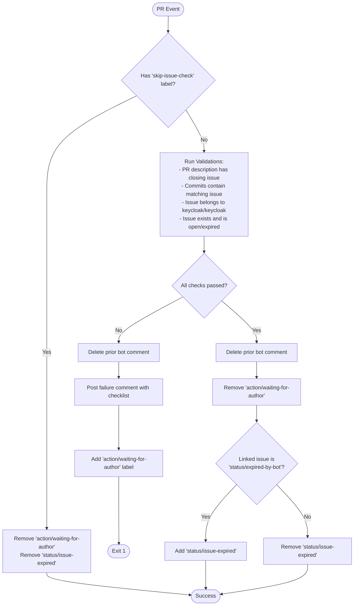
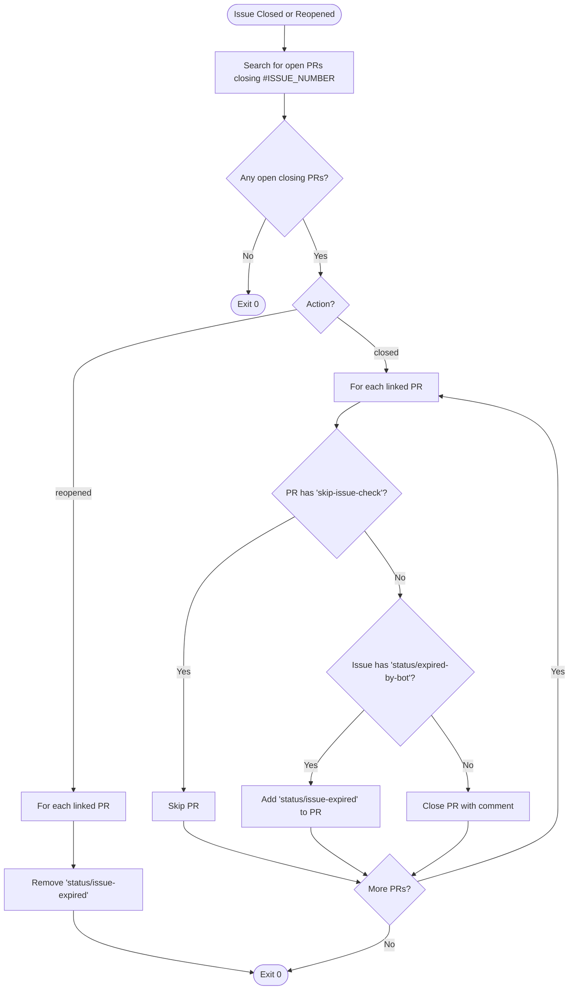

# Pull Request and Issue Pre-Triage Automation

This directory contains scripts used by Keycloak's GitHub Actions workflows to validate pull request issue links and synchronize pull request lifecycles with linked issues.

## Table of Contents

- [Overview](#overview)
- [Pre-Triage Pull Request Validation (`pre-triage-pr.sh`)](#pre-triage-pull-request-validation-pre-triage-prsh)
  - [Workflow Trigger & Concurrency](#workflow-trigger--concurrency)
  - [Validation Rules](#validation-rules)
  - [State Transitions & Labels](#state-transitions--labels)
  - [Pre-Triage Flow Diagram](#pre-triage-flow-diagram)
- [Issue Closure & Reopen Handling (`issue-closure.sh`)](#issue-closure--reopen-handling-issue-closuresh)
  - [Workflow Trigger](#workflow-trigger)
  - [Discovery of Linked PRs](#discovery-of-linked-prs)
  - [State Transitions & Actions](#state-transitions--actions)
  - [Issue Lifecycle Flow Diagram](#issue-lifecycle-flow-diagram)
- [Developer Usage & Examples](#developer-usage--examples)
  - [Prerequisites](#prerequisites)
  - [Running `pre-triage-pr.sh`](#running-pre-triage-prsh)
  - [Running `issue-closure.sh`](#running-issue-closuresh)
  - [Dry-Run Mode](#dry-run-mode)

---

## Overview

Keycloak requires all contributions to be tied to valid, open issues in the `keycloak/keycloak` repository. To automate and enforce this policy:

1. **[`pre-triage-pr.sh`](pre-triage-pr.sh:1)** (invoked by [`.github/workflows/pre-triage-pr.yml`](../workflows/pre-triage-pr.yml:1)) validates linked issues whenever a PR is opened, updated, or re-labeled.
2. **[`issue-closure.sh`](issue-closure.sh:1)** (invoked by [`.github/workflows/issue-closure.yml`](../workflows/issue-closure.yml:1)) updates or closes open PRs when their corresponding issues are closed or reopened.

---

## Pre-Triage Pull Request Validation (`pre-triage-pr.sh`)

### Workflow Trigger & Concurrency

- **Workflow**: `Pre-triage Pull Request` ([`.github/workflows/pre-triage-pr.yml`](../workflows/pre-triage-pr.yml:1))
- **Events**: `pull_request_target` types: `[opened, edited, reopened, synchronize, labeled, unlabeled, ready_for_review]` targeting `main`.
- **Concurrency**: Grouped by `pre-triage-pr-${{ github.event.pull_request.number }}` with `cancel-in-progress: true`.

### Validation Rules

```
                      PR Opened / Updated
                              │
                    Is 'skip-issue-check'
                        label present?
                         /          \
                      Yes            No
                      /                \
             Skip validations    1. Strip HTML comments from PR body
                                 2. Extract closing issue keywords
                                 3. Scan all commit messages for issue keywords
                                 4. Query GitHub GraphQL closingIssuesReferences
                                 5. Validate issue existence, repository & state
```

1. **Skip Check**:
   - If the PR has the `skip-issue-check` label, all issue validations are bypassed.
2. **Comment Stripping**:
   - HTML comments (`<!-- ... -->`) in the PR description are stripped before parsing so hidden template text or examples do not count as linked issues.
3. **Closing Keyword Syntax**:
   - Accepts GitHub closing keywords: `close`, `closes`, `closed`, `fix`, `fixes`, `fixed`, `resolve`, `resolves`, `resolved` (case-insensitive, optional colon).
   - Formats supported: `#NNN`, `owner/repo#NNN`, or `https://github.com/owner/repo/issues/NNN`.
4. **PR Description Requirement**:
   - The PR description must contain at least one linked issue with a closing keyword.
   - *Error if missing*: `"PR description must contain a linked issue (e.g. 'Closes #NNN')"`
5. **Commit Message Consistency**:
   - Every issue linked in the PR description must also be referenced with a closing keyword in at least one commit message.
   - Every issue referenced with a closing keyword in any commit message must also be present in the PR description.
   - *Error if missing from commits*: `"Issue <ref> is linked in the PR description but not in a commit message"`
   - *Error if in commits but not PR*: `"<ref> is linked in the commit messages but not in the PR description."`
6. **Repository Match**:
   - Issues must belong to the target repository (`keycloak/keycloak`). Cross-repository issue links with closing keywords are rejected.
   - *Error*: `"Issue <ref> in the PR description is from a different repository - do not use a closing keyword with it."`
7. **Issue Existence**:
   - Verified against GitHub's GraphQL `closingIssuesReferences`.
   - *Error if reference is not an issue*: `"<ref> is linked in the PR description but is not an issue - do not use a closing keyword with it."`
8. **Open State vs. Expired State**:
   - Linked issues must be open.
   - If an issue is closed and **not** labeled `status/expired-by-bot`, it is rejected.
     - *Error*: `"Issue <ref> is not open (current state: closed)"`
   - If a closed issue has the `status/expired-by-bot` label, it is accepted, but the PR is flagged as having an expired issue.
9. **Manual Link Consistency**:
   - If GitHub reports a manually linked issue in `closingIssuesReferences` that is absent from the PR description:
     - *Error*: `"Issue <ref> is a manually linked GitHub issue, but it's not in the PR description."`

### State Transitions & Labels

| Validation Result | Previous Bot Comment | PR Comment | Label `action/waiting-for-author` | Label `status/issue-expired` | Exit Code |
| :--- | :--- | :--- | :--- | :--- | :--- |
| **Failed** | Deleted if present | Posted with failure list | **Added** | Unchanged | `1` |
| **Passed (Open Issue)** | Deleted if present | None | **Removed** | **Removed** | `0` |
| **Passed (Expired Issue)** | Deleted if present | None | **Removed** | **Added** | `0` |
| **Skipped (`skip-issue-check`)** | Deleted if present | None | **Removed** | **Removed** | `0` |

### Pre-Triage Flow Diagram



---

## Issue Closure & Reopen Handling (`issue-closure.sh`)

### Workflow Trigger

- **Workflow**: `Issue Closed or Reopened` ([`.github/workflows/issue-closure.yml`](../workflows/issue-closure.yml:1))
- **Events**: `issues` types: `[closed, reopened]`.
- **Concurrency**: Grouped by `issue-closed-${{ github.event.issue.number }}` with `cancel-in-progress: true`.

### Discovery of Linked PRs

1. Searches for open PRs in the repository referencing `#<ISSUE_NUMBER>`.
2. For each candidate PR, queries GraphQL `closingIssuesReferences` to verify the PR actively closes the issue when merged.
3. If no open closing PRs are found, the workflow exits with no action.

### State Transitions & Actions

| Issue Action | Issue State / Labels | Linked PR Labels | Action on Linked PR |
| :--- | :--- | :--- | :--- |
| **`reopened`** | Any | Has `status/issue-expired` | **Removes** `status/issue-expired` label |
| **`reopened`** | Any | No `status/issue-expired` | No-op |
| **`closed`** | Labeled `status/expired-by-bot` | Has `skip-issue-check` | Skipped |
| **`closed`** | Labeled `status/expired-by-bot` | No `skip-issue-check` | **Adds** `status/issue-expired` label |
| **`closed`** | Normal closure (not expired) | Has `skip-issue-check` | Skipped |
| **`closed`** | Normal closure (not expired) | No `skip-issue-check` | **Closes PR** with comment: *"Closing this pull request because the linked issue #NNN has been closed."* |

### Issue Lifecycle Flow Diagram



---

## Developer Usage & Examples

### Prerequisites

Ensure you have the following installed and authenticated:
- **`gh`** ([GitHub CLI](https://cli.github.com/)) - authenticated with `gh auth login`
- **`jq`** - JSON query utility
- **`perl`** - used for regular expression matching

### Running `pre-triage-pr.sh`

```bash
# General syntax
./.github/scripts/pre-triage-pr.sh [--dry-run] [PR_NUMBER] [REPO]
```

#### Examples

1. **Dry-run validation on a specific PR**:
   ```bash
   ./.github/scripts/pre-triage-pr.sh --dry-run 54652
   ```

2. **Dry-run validation on a fork or custom repository**:
   ```bash
   ./.github/scripts/pre-triage-pr.sh --dry-run 123 my-org/keycloak
   ```

3. **Running using environment variables**:
   ```bash
   export PR_NUMBER=54652
   export REPO=keycloak/keycloak
   export DRY_RUN=true
   ./.github/scripts/pre-triage-pr.sh
   ```

4. **Testing a custom PR body locally**:
   ```bash
   PR_BODY="Fixes #54647" ./.github/scripts/pre-triage-pr.sh --dry-run 54652
   ```

### Running `issue-closure.sh`

```bash
# General syntax
./.github/scripts/issue-closure.sh [--dry-run] [ISSUE_NUMBER] [ACTION] [REPO]
```

`ACTION` defaults to `closed` if omitted. Allowed values: `closed`, `reopened`.

#### Examples

1. **Dry-run check when an issue is closed**:
   ```bash
   ./.github/scripts/issue-closure.sh --dry-run 54647 closed
   ```

2. **Dry-run check when an issue is reopened**:
   ```bash
   ./.github/scripts/issue-closure.sh --dry-run 54647 reopened
   ```

3. **Running against a specific repository**:
   ```bash
   ./.github/scripts/issue-closure.sh --dry-run 1234 closed my-org/keycloak
   ```

### Dry-Run Mode

Passing `--dry-run`, `-n`, or setting `DRY_RUN=true` guarantees that:
- No comments are posted or deleted on GitHub.
- No labels are added or removed.
- No pull requests are closed.
- Expected actions are printed with a `[DRY-RUN]` prefix to stdout/stderr.
- Validation exit codes still reflect pass (`0`) or fail (`1`), allowing local testing in scripts.
