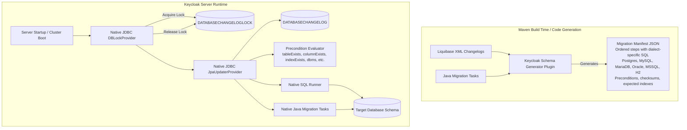
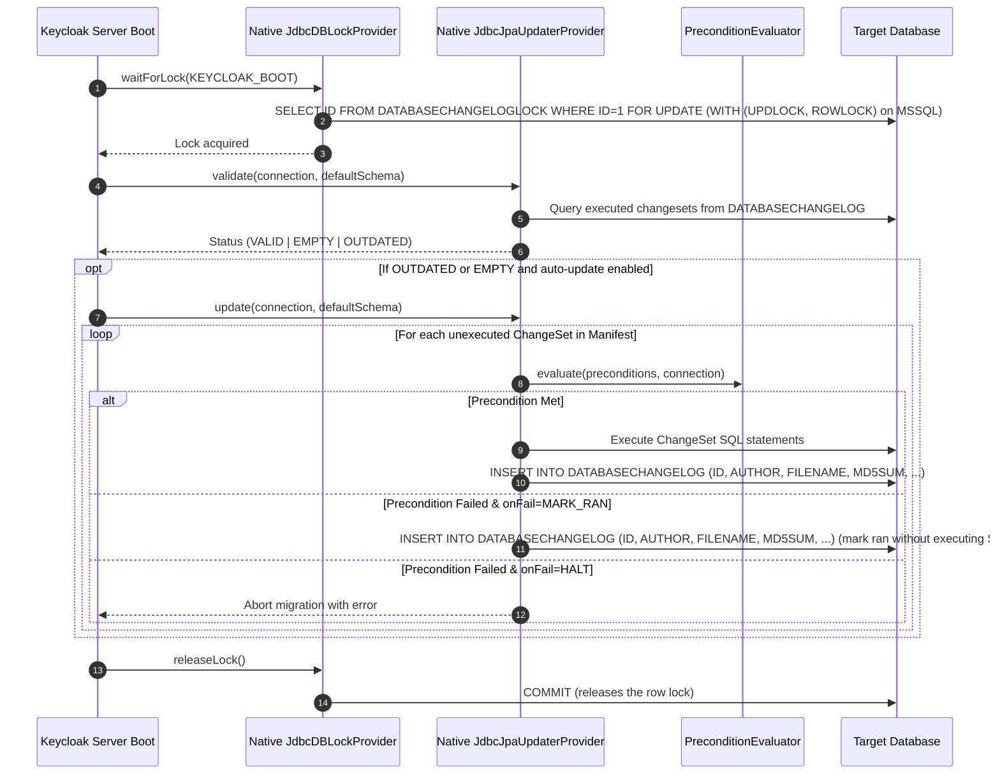
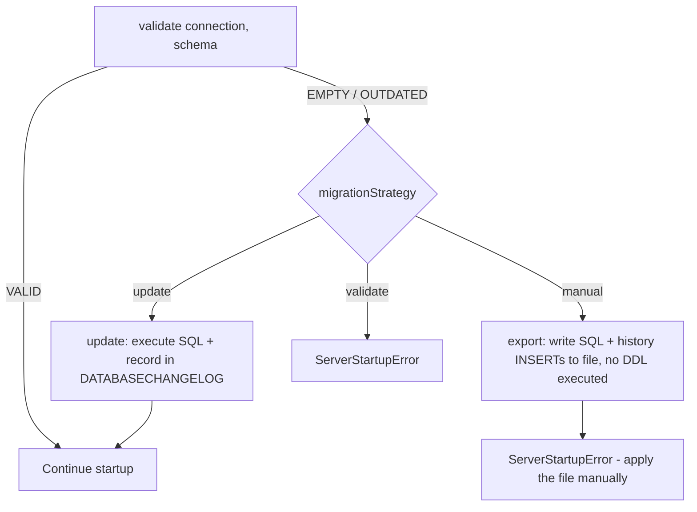

# Architecture & Implementation Plan: Decoupling Liquibase from Keycloak Runtime



---

## 1. Motivation and Objectives

1. **Eliminate Runtime Liquibase Dependency:** Remove `liquibase-core` from `model/jpa/pom.xml`, `quarkus/runtime/pom.xml`, and `dependencies/server-all/pom.xml`.
2. **Optimize Startup & Memory Footprint:** Eliminate Liquibase's heavy reflection, dynamic service discovery, runtime XML parsing, and dynamic JDBC metadata inspection during server boot.
3. **Simplify Quarkus & Native Compilation:** Remove `LiquibaseProcessor.java`, `FastServiceLocator`, and extensive reflection registrations for Liquibase classes in GraalVM native images.
4. **Preserve Database Compatibility:** Maintain exact schema compatibility and changelog history records (`DATABASECHANGELOG` table and `DATABASECHANGELOGLOCK` table) so existing deployments can seamlessly upgrade and downgrade between versions.
5. **Deterministic Schema DDL:** Produce human-auditable, dialect-specific SQL scripts during the build that can be directly inspected, executed, or exported via CLI.

---

## 2. Current State Analysis

Before this work Liquibase was embedded across several runtime layers (this table describes the starting point; the classes listed in the "Current Implementation" column have been removed, see Phase 7):

| Component | Current Implementation | Files |
| :--- | :--- | :--- |
| **Schema Validation & Update** | `LiquibaseJpaUpdaterProvider`, `QuarkusJpaUpdaterProvider` | `model/jpa/.../JpaUpdaterProvider.java`, `quarkus/runtime/.../QuarkusJpaUpdaterProvider.java` |
| **Cluster Database Locking** | `LiquibaseDBLockProvider` using `CustomLockService` | `model/jpa/.../lock/LiquibaseDBLockProvider.java`, `model/storage-private/.../dblock/DBLockProvider.java` |
| **Custom Java Migrations** | Implementations of `CustomSqlChange` extending `CustomKeycloakTask` | `model/jpa/.../custom/*` |
| **Database Index Verification** | In-memory changelog traversal and SQL generation in `DatabaseIndexChecker` | `quarkus/runtime/.../jpa/DatabaseIndexChecker.java` |
| **Quarkus Native Build** | Service loading, reflection configuration, and build-item indexing in `LiquibaseProcessor` | `quarkus/deployment/.../LiquibaseProcessor.java`, `KeycloakProcessor.java` |
| **SPI / Custom Entity Providers** | Extension point `JpaEntityProvider.getChangelogLocation()` | `model/jpa/.../entityprovider/JpaEntityProvider.java` |

---

## 3. Target Architecture & Runtime Sequence



---

## 3.1 Migration Strategies: `update`, `manual` and `validate`

`QuarkusJpaConnectionProviderFactory.createOrUpdateSchema` drives three strategies (`migrationStrategy`, plus `initializeEmpty` and `migrationExport`) through only three `JpaUpdaterProvider` calls: `validate()`, `update()` and `export()`. The strategy logic stays where it is; the native updater must preserve the contract of each call so the behaviour is unchanged.

| Strategy | Calls | Behaviour that must be preserved |
| :--- | :--- | :--- |
| `update` (default) | `validate()` then `update()` under the DB lock | Applies pending change-sets. |
| `manual` | `validate()` then `export()` under the DB lock, then `ServerStartupError` | Writes pending SQL to `migrationExport` (default `keycloak-database-update.sql`) **without modifying the schema**, then stops the server. |
| `validate` | `validate()` only | Fails with `ServerStartupError` if status is `EMPTY` or `OUTDATED`. Must not change the database. |



### 3.1.1 Verify (`validate`) mode requirements
- `JdbcJpaUpdaterProvider.validate()` must be **strictly read-only**. Today Liquibase creates `DATABASECHANGELOG` and adds the `DEPLOYMENT_ID` column as a side effect of parsing/validating (see `LiquibaseJpaUpdaterProvider.updateChangeSet` and the `masterChangelogTablePreExisted` handling). The native implementation should only `SELECT` from `DATABASECHANGELOG`, treating "table does not exist" as `EMPTY`, so `validate` works for DB users without DDL rights.
- Status is computed by comparing the manifest's change-set identities (`id`, `author`, `changeLogFile`) with `DATABASECHANGELOG`: none ran → `EMPTY`; some pending → `OUTDATED`; all ran → `VALID`. This must cover the master changelog **and** each custom `JpaEntityProvider` changelog/changelog table (`JpaUtils.getCustomChangelogTableName`), returning `OUTDATED` if any custom provider is behind.
- Preserve the `VERIFY_AND_RUN_MASTER_CHANGELOG` session attribute behaviour set by the factory.
- `validate()` must not take the DB lock or execute change-sets; preconditions are not evaluated (identity comparison only), matching current `listUnrunChangeSets` semantics.

### 3.1.2 Manual (`export`) mode requirements
`JdbcJpaUpdaterProvider.export(connection, schema, file)` must produce a script equivalent to what `liquibase.update(..., writer)` produces today:
1. **Header comments** (`Keycloak database creation script - apply this script to empty DB`) when the DB is empty.
2. **History table DDL**: emit `CREATE TABLE DATABASECHANGELOG` only if the table did not exist when the server started (an admin may have pre-created it), plus the MySQL/MariaDB primary key statement (currently `MySQLCustomChangeLogHistoryService`). `DATABASECHANGELOGLOCK` is *not* included; it is created by `JdbcDBLockProvider.initLockTable()` before export runs.
3. **Per pending change-set**, in manifest order and only those not in `DATABASECHANGELOG`: a comment with id/author/file, the pre-generated dialect SQL, and the `INSERT INTO DATABASECHANGELOG (...)` statement (including `EXECTYPE`, `MD5SUM`, `DEPLOYMENT_ID`, `ORDEREXECUTED`). For `MARK_RAN` outcomes only the INSERT is emitted.
4. **Preconditions** are evaluated against the live database at export time (same as Liquibase update-SQL), and `HALT` still aborts the export.
5. **Missing `DEPLOYMENT_ID` column**: emit the `ALTER TABLE ... ADD DEPLOYMENT_ID` / `UPDATE` / `NOT NULL` statements to the script rather than executing them.
6. **Custom provider changelogs** are appended after the master changelog, each against its own history table.
7. **Nothing is executed**: no DDL, no history inserts, no Java-task side effects. A `SqlSink` abstraction (execute-to-connection vs. write-to-`Writer`) should be used by the shared change-set runner so `update` and `export` share one code path.
8. **Dialect fidelity**: the file must be runnable with the vendor's own client (`psql`, `mysql`, `sqlplus`, `sqlcmd`). `ScriptSqlSink` appends the terminator when writing: `GO` on its own line for MSSQL and `;` for every other dialect (including Oracle). Keycloak's generated statements contain no PL/SQL blocks, so no Oracle `/` terminator is needed; add one if that ever changes.

### 3.1.3 Impact on Java migration tasks
Export mode is the main constraint on Phase 4: a task that just executes JDBC directly (`run(Connection)`) **cannot be exported**. Existing `CustomKeycloakTask`s work in export mode because they only *generate* `SqlStatement`s (`generateStatementsImpl`) from the current database state, and Liquibase writes them to the file. The replacement `JpaMigrationTask` must therefore keep the generate-then-apply model (see Phase 4).

---

## 4. Phased Implementation Plan

### Phase 1: Build-Time SQL and Manifest Generation — ✅ **Done**
A Maven plugin, `misc/schema-generator-maven-plugin` (`keycloak-schema-generator-maven-plugin`, goal `generate-schema`, default phase `process-resources`), executes Liquibase offline and is wired into `model/jpa/pom.xml`:

1. **Supported Dialects:** PostgreSQL, MySQL, MariaDB, Oracle, Microsoft SQL Server and H2. The list is not configured by hand: `SchemaGenerator.DEFAULT_DIALECTS` is derived from `org.keycloak.enums.SqlDialect.values()` (minus `OTHER`), and can be overridden with the `dialects` mojo parameter.
2. **Offline Liquibase Execution:**
   - The generator parses `jpa-changelog-master.xml` and creates an `OfflineConnection("offline:<dialect>")` per dialect, then renders each change through Liquibase's SQL generators.
   - `setOutputDefaultSchema(false)` keeps scripts unqualified (see F3).
3. **Generate Migration Manifest (`META-INF/schema/migration-manifest.json`):** a single JSON file; **no per-dialect `.sql` files are produced**.
   - Change-set metadata: `id`, `author`, `changeLogFile`, `checkSum` (Liquibase `9:` checksum), `order`, `description`, `comments`, `dbms`, precondition AST (see Section 5).
   - Ordered `steps` per change-set (`sql`, `createIndex`, `customTask`), where each `sql`/`createIndex` step carries `statements: { <dialect>: [sql, ...] }`. Statements are stored **without** a trailing `;`; the sink adds the terminator (see 3.1.2 item 8).
   - `expectedIndexes: { <dialect>: [ {tableName, indexName, sql} ] }` used by `DatabaseIndexChecker` (Phase 5).

### Phase 2: Native JDBC Database Locking (`DBLockProvider`) — ✅ **Done**
`LiquibaseDBLockProvider` and `CustomLockService` were replaced by `JdbcDBLockProvider` (`model/jpa/.../connections/jpa/lock/`, factory id `jpa`):

1. **Table Schema Maintenance:** `DATABASECHANGELOGLOCK` is created if missing with columns `(ID INT NOT NULL, LOCKED <boolean type>, LOCKGRANTED <timestamp type>, LOCKEDBY <varchar(255)>)` and primary key `PK_DATABASECHANGELOGLOCK`; column types are chosen per `SqlDialect` in `JdbcDBLockProvider.createTableSql()`.
2. **Lock Acquisition:**
   - A row lock is taken with `SELECT ID FROM DATABASECHANGELOGLOCK WHERE ID=<n> FOR UPDATE` (MySQL, PostgreSQL, H2, Oracle) or `... WITH (UPDLOCK, ROWLOCK) WHERE ID=<n>` (MSSQL), on a dedicated connection with auto-commit disabled. For an unrecognised database no lock is taken and a warning is logged.
   - Initialisation of the lock table retries with backoff (`Retry.executeWithBackoff`), and acquisition retries until the configured timeout.
3. **Unlock:** the lock is released by committing the transaction that holds the row lock. There is no `LOCKED` flag update.

### Phase 3: Native JDBC Migration Engine & Precondition Evaluator (`JpaUpdaterProvider`) — ✅ **Done**
`JdbcJpaUpdaterProvider` is the only implementation of `JpaUpdaterProvider`.

**Delivery was split into four sub-steps (3a-3d). See Section 7 for the record of findings and what was done in each.**

| Step | Scope |
| :--- | :--- |
| **3a** | Generator/manifest fixes (ordered steps, schema placeholder, index marking, remaining preconditions) |
| **3b** | Read-only core: manifest loader, dialect detection, history reader, `PreconditionEvaluator`, `validate()` |
| **3c** | Execution: `SqlSink`, `update()`, `export()`, `DEPLOYMENT_ID`, MySQL PK, `MARK_RAN`/`HALT`, delimiters |
| **3d** | Wiring: factory, service registration, Quarkus switch, `JpaMigrationTask` hook, native handling of custom-provider manifests |

1. **History Tracking (`DATABASECHANGELOG`):**
   - `ChangeLogHistory.loadExecuted` reads `SELECT ID, AUTHOR, FILENAME FROM DATABASECHANGELOG` (read-only, returns an empty set when the table does not exist) and `computePending` compares the result with the manifest. Matching is case-insensitive on the `(ID, AUTHOR, FILENAME)` triple; `MARK_RAN` rows count as executed.
2. **Status Evaluation:**
   - Return `Status.EMPTY` if none of the *applicable* manifest change-sets (those not excluded by their `dbms` attribute for the current dialect) are recorded.
   - Return `Status.VALID` if all applicable manifest change-sets are recorded.
   - Return `Status.OUTDATED` otherwise.
3. **Execution Pipeline:**
   - Each change-set (its steps plus the history `INSERT`) is committed as a unit; on failure it is not committed and the exception aborts the migration.
   - Completion records match Liquibase's column types and format to preserve backward/forward compatibility.
4. **SQL Export (`export(connection, defaultSchema, file)`) — `manual` strategy:**
   - Write the manifest statements of the pending change-sets into the output file, with the dialect-specific terminator added by `ScriptSqlSink`.
   - Follow the full requirements in Section 3.1.2: header, conditional `DATABASECHANGELOG` DDL (+ MySQL PK), per-change-set SQL followed by the history `INSERT`, preconditions evaluated live, custom-provider changelogs, and no side effects on the database.
   - Implement `update` and `export` over one change-set runner parameterised by a `SqlSink` (JDBC executor vs. file writer).
5. **Validation (`validate(connection, defaultSchema)`) — `validate` strategy:**
   - Read-only comparison of manifest identities vs. `DATABASECHANGELOG` for the master and every custom provider changelog (Section 3.1.1); never create tables/columns.

### Phase 4: Refactor Custom Java Migrations (`CustomKeycloakTask`) — ✅ **Done**
The existing classes extending `CustomKeycloakTask` were migrated to native Keycloak migration tasks (the full list is in 7.3):

1. **`JpaMigrationTask` interface:**
   Tasks must be able to participate in `export` (manual) mode, so they return the statements to run instead of executing them directly; the updater applies them to the connection (`update`) or writes them to the script (`export`):
   ```java
   public interface JpaMigrationTask {
       String getTaskId();
       /** Default: the REALM table exists and has at least one row. */
       default boolean isApplicable(Connection connection, String defaultSchema) throws SQLException { ... }
       /** Inspect current DB state (read-only) and return the SQL to apply. */
       List<String> generateStatements(KeycloakSession session, Connection connection, String defaultSchema) throws SQLException;
   }
   ```
   Tasks that need Java-side processing (e.g. loading and rewriting JSON via the `KeycloakSession`) are expressed as generated `UPDATE`/`INSERT` statements, exactly as `CustomKeycloakTask` did. Read-only queries in `generateStatements` (including the `isApplicable()` check on `REALM`) are allowed in export mode.
2. **Migrate Existing Tasks:**
   - The 35 tasks that the manifest references were converted to plain-JDBC statement generators in `model/jpa/.../updater/jdbc/task/` and are mapped from their historic manifest class names by `JpaMigrationTaskRegistry`.
   - Tasks receive direct access to `Connection` and `KeycloakSession` without needing `ThreadLocalSessionContext` or Liquibase's `CustomSqlChange`.

### Phase 5: Refactor Database Index Checker (`DatabaseIndexChecker`) — ✅ **Done**
1. In `DatabaseIndexChecker.java`, remove Liquibase change-log inspection.
2. Load expected indexes directly from the generated manifest (`IndexInfo` list per dialect generated at build time).
3. Compare against `connection.getMetaData().getIndexInfo(...)` as done currently.

**Implementation notes:**
- `SchemaGenerator` now also writes `expectedIndexes: { <dialect>: [ {tableName, indexName, sql} ] }` into the manifest. `ExpectedIndexComputer` (plugin) replays the whole changelog per dialect with the same transient model the checker used at runtime (`createIndex`/`dropIndex`/`createTable`/`dropTable`; preconditions `dbms`, `changeSetExecuted`, `indexExists`, `tableExists`, `and`/`or`/`not`; all others default to true). The index SQL is the *original* `CREATE INDEX` (never the threshold-skipped empty statement) with SQL visitors applied and the schema placeholder removed.
- `ExpectedIndexDescriptor` lives in `keycloak-core` (`org.keycloak.representations.migration`) with the other manifest classes; `MigrationManifest` gained `expectedIndexes`.
- `DatabaseIndexChecker` (quarkus/runtime) now resolves the dialect with `SqlDialect.of(connection)` and reads `MigrationManifestLoader.load().getExpectedIndexes()`. All `liquibase.*` and `LiquibaseConnectionProvider`/`CustomCreateIndexChange` imports and the in-class precondition evaluator were removed. It no longer opens a `KeycloakSession` just to build a Liquibase instance.
- Because manifest SQL is unqualified (F3), `createIndexes` sets `connection.setSchema(dbSchema)` for the duration of the creation and restores the original schema afterwards. The Postgres invalid-index handling (`qualifyPostgresIdentifier`) is unchanged.
- Tests: `SchemaGeneratorTest` (expected indexes for the test changelog and the master changelog: 125 per dialect, 124 for h2/mssql, partial-index SQL present), `ExpectedIndexManifestTest` (model/jpa, 3 tests), and the unchanged `DatabaseIndexCheckerTest` passes in embedded mode (`-Dkc.test.server=embedded`).
- `CustomCreateIndexChange` was removed in Phase 7.

### Phase 6: SPI Evolution & Custom Providers (`JpaEntityProvider`) — ✅ **Done**
1. Provided a transition strategy for custom entity providers implementing `JpaEntityProvider`:
   - `JpaEntityProvider.getMigrationManifest()` is the new SPI method; `getChangelogLocation()` is `@Deprecated(forRemoval = true)` with a Javadoc pointer to the replacement.
   - `JdbcJpaUpdaterProvider` only calls `getMigrationManifest()`; custom provider change-sets run natively against a dedicated `DATABASECHANGELOG_<factoryId>` table, tracked independently from the master changelog.
   - Migration manifest descriptor classes (`MigrationManifest`, `ChangeSetDescriptor`, `ChangeSetStep`, `ExpectedIndexDescriptor`, `PreconditionDescriptor`, `PreconditionContainerDescriptor`) moved to `keycloak-core` (`org.keycloak.representations.migration`) so they can be shared by the generator plugin, runtime engine, and custom provider extensions without class duplication.
   - `ExampleJpaEntityProvider` (Arquillian testsuite) converted from `getChangelogLocation()` to `getMigrationManifest()`, providing a working reference implementation.
   - Developer documentation (`docs/documentation/server_development/topics/extensions.adoc`) updated to show the new API and explain the manifest model.
   - Migration guide entry added in `changes-27_0_0.adoc` noting the deprecation.
   - `ChangeLogHistory.namedTableExists()` added (package-visible) and `loadExecuted` now uses it for all table names, so the first-boot case for custom provider tables (history table does not yet exist) returns an empty set instead of throwing.
   - 5 unit tests added in `JdbcJpaUpdaterProviderValidateTest`: `testLoadExecutedOnMissingCustomProviderTableReturnsEmpty`, `testCustomProviderManifestAllPendingWhenTableMissing`, `testCustomProviderManifestNoPendingWhenAlreadyExecuted`, `testCustomProviderRunnerExecutesAndRecordsHistory`, `testNamedTableExistsFalseAndTrue`.

### Phase 7: Dependency Cleanup & Quarkus Optimization — ✅ **Done** (runtime); follow-ups in 8.5

**Removed:**
- `org.liquibase:liquibase-core` from `model/jpa/pom.xml`, `quarkus/runtime/pom.xml` and `dependencies/server-all/pom.xml`. It is now only a dependency of `misc/schema-generator-maven-plugin` (build time).
- The whole `model/jpa/.../updater/liquibase` package: `LiquibaseJpaUpdaterProvider(+Factory)`, `LiquibaseConnectionSpi`/`Provider`/`DefaultLiquibaseConnectionProvider`/`KeycloakLiquibase`, `MySQLCustomChangeLogHistoryService`, `DummyLockService`, `KeycloakLogger`/`KeycloakLogService`, `ThreadLocalSessionContext`, `LiquibaseConstants`, `CustomCreateIndexChange`, `CreateTableAsSelectGuard`, `CustomKeycloakTask`, `AbstractUserFedToComponent` and all 35 old `CustomKeycloakTask` subclasses (`custom/*`). The native `*Task` classes in `updater/jdbc/task` are the only implementations.
- All `META-INF/services/liquibase.*` files in `model/jpa` and `quarkus/runtime`, the `LiquibaseConnectionSpi`/`LiquibaseConnectionProviderFactory` registrations, and the legacy `JpaUpdaterProviderFactory` registrations.
- `quarkus/runtime/.../storage/database/liquibase/*` (`QuarkusJpaUpdaterProvider(+Factory)`, `QuarkusLiquibaseConnectionProvider`, `FastServiceLocator`, `KeycloakLogger`, `KeycloakLogService`, `CustomMSSQLDatabase`), `LiquibaseProcessor`, `KeycloakRecorder.configureLiquibase`, the `liquibase-core` jandex index entry and the `liquibase.database.core.PostgresDatabase` log suppression in `application.properties`.
- `Database.Vendor.liquibaseType` / `isLiquibaseDatabaseSupported` in `quarkus/config-api`.
- The `PRESERVE_SCHEMA_CASE` handling in `AbstractJpaConnectionProviderFactory` / `DefaultJpaConnectionProviderFactory.getSchema()`.

**Kept at build time (moved into `misc/schema-generator-maven-plugin`):** `UpdatedMySqlDatabase`, `UpdatedMariaDBDatabase` (reserved word `PERIOD` is quoted) and `MySQL8VarcharType` (VARCHAR > 255 becomes TEXT on MySQL 8) with their `META-INF/services` registrations. The generated manifest was verified byte-identical (ignoring `generatedAt`) before and after the move.

**Behavioural changes to be aware of:**
- `JdbcJpaUpdaterProviderFactory` (id `jdbc`) is the only `JpaUpdaterProviderFactory`; `order()` is no longer needed. It now owns the `index-creation-threshold` option (default 300000): `--spi-connections-jpa-updater--jdbc--index-creation-threshold`. The old `connections-liquibase` SPI no longer exists. `JdbcJpaUpdaterProvider` takes the threshold through its constructor.
- `QuarkusJpaConnectionProviderFactory` imports `VERIFY_AND_RUN_MASTER_CHANGELOG` from `JdbcJpaUpdaterProvider`.
- Schemas that are not simple identifiers (for example `keycloak-t`) are not embedded in SQL any more: `NativeSqlHelper.qualified()` omits them and the updater relies on `connection.setSchema()` (which the driver quotes). Covered by `PreserveSchemaCaseLiquibaseTest` and `JpaMigrationTaskRegistryTest#testQualifiedOmitsSchemaThatNeedsQuoting`.
- `PropertyMappingInterceptor` used `org.apache.commons.collections4.IteratorUtils`, which only arrived transitively through Liquibase. It now chains the two iterators itself (must stay lazy: `Stream.concat` causes a `ConcurrentModificationException` during Quarkus augmentation).
- The testsuite loggers moved from `org.keycloak.connections.jpa.updater.liquibase` to `...updater.jdbc`; `LoggingDistTest` no longer asserts on `liquibase.servicelocator`.
- Documentation: `migrate_db.adoc` (new SPI name, no Liquibase wording) and a "Notable changes" entry in `changes-27_0_0.adoc`.

**Regressions found by the distribution tests and fixed:**
- Export mode on an empty database failed with `Table "DATABASECHANGELOG" not found`, because `ChangeLogHistory.maxOrderExecuted` queried a history table that is only written to the script. It now returns `0` when the table does not exist.
- The old `CustomKeycloakTask.isApplicable()` guard was lost: every task ran, even when `REALM` did not exist or was empty, so export on an empty database failed with `Table "OFFLINE_CLIENT_SESSION" not found`, and on initial creation tasks would have tried to migrate non-existent data. `JpaMigrationTask` now has a default `isApplicable(connection, schema)` (REALM table exists and has a row, checked via metadata first so a failing query cannot abort a PostgreSQL transaction), which `ChangeSetRunner` checks before `generateStatements`. `JpaUpdate26_5_0_OrgTablesSetDefaultCharsetAndCollationTask` overrides it to `true`, as the old class did (it must run during initial creation).
- `ManualMigrationEmptyDatabaseDistTest` and `ManualMigrationCustomProviderDistTest` asserted on Liquibase's `PUBLIC.`-qualified table names. The native export does not qualify names when no schema is configured, so the expected strings are now unqualified.

**Tests run for Phase 7:** `mvn install` of `misc/schema-generator-maven-plugin` (2 `SchemaGeneratorTest`; `ManifestDriftCheckerTest` added afterwards, 3), `model/jpa` (78 at the consistency review: 3 `ExpectedIndexManifestTest`, 49 `JdbcJpaUpdaterProviderValidateTest`, 18 `JpaMigrationTaskRegistryTest`, 8 others), `quarkus/runtime` configuration tests (228); embedded `DatabaseIndexCheckerTest` (3) and `PreserveSchemaCaseLiquibaseTest` (1); distribution mode `LiquibaseDistTest` (1), `LoggingDistTest` (30), `ManualMigrationEmptyDatabaseDistTest` (1), `ManualMigrationCustomProviderDistTest` (1); compile of `testsuite/model`, `testsuite-providers`, `quarkus/tests/*`. The distribution zip contains no `liquibase` jars. See 8.5 for what was not run.

---

## 5. Precondition & Conditional Logic Specification

The build-time generator serializes `<preConditions>` into a lightweight JSON AST in the manifest (`PreconditionContainerDescriptor` with `onFail`, `onError`, `onSqlOutput` and `conditions`; each node is a `PreconditionDescriptor`). The runtime `PreconditionEvaluator` executes JDBC metadata queries or lightweight SQL checks:

| Precondition Tag | Build-Time Manifest Representation | Native Runtime JDBC Verification |
| :--- | :--- | :--- |
| `<tableExists tableName="..."/>` | `{"type": "tableExists", "tableName": "ORG"}` | `DatabaseMetaData.getTables(null, schema, tableName, null).next()` |
| `<columnExists tableName="..." columnName="..."/>` | `{"type": "columnExists", "tableName": "REALM", "columnName": "DISPLAY_NAME"}` | `DatabaseMetaData.getColumns(null, schema, tableName, columnName).next()` |
| `<indexExists tableName="..." indexName="..."/>` | `{"type": "indexExists", "tableName": "ROOT_AUTH_SESSION", "indexName": "IDX_..."}` (`tableName` optional) | `DatabaseMetaData.getIndexInfo(null, schema, tableName, false, false)` query matching index name; without a table name every table in the schema is scanned |
| `<foreignKeyConstraintExists .../>` | `{"type": "foreignKeyExists", "foreignKeyName": "FK_ORG_DOMAIN_ORG"}` (`tableName` optional) | `DatabaseMetaData.getImportedKeys(null, schema, table)` |
| `<uniqueConstraintExists .../>` | `{"type": "uniqueConstraintExists", "tableName": "...", "constraintName": "..."}` | unique-only `DatabaseMetaData.getIndexInfo` matching the constraint name |
| `<primaryKeyExists .../>` | `{"type": "primaryKeyExists", "tableName": "...", "primaryKeyName": "..."}` | `DatabaseMetaData.getPrimaryKeys` (not used by the current changelogs) |
| `<sqlCheck expectedResult="1">` | `{"type": "sqlCheck", "sql": "SELECT COUNT(*) ...", "expectedResult": "1"}` | `PreparedStatement.executeQuery()` and compare scalar output (not used by the current changelogs) |
| `<changeSetExecuted id="..." author="..." changeLogFile="..."/>` | `{"type": "changeSetExecuted", "changeSetId": "...", "changeSetAuthor": "...", "changeSetFile": "..."}` | Check the set of change-sets already in `DATABASECHANGELOG` plus those processed earlier in the same run |
| `<dbms type="postgresql"/>` | `{"type": "dbms", "dbmsType": "postgresql"}` | `SqlDialect.matchesDbmsType`. Note that the changelogs also use `db2`, which no `SqlDialect` matches, so `dbms=db2` is always false |
| `<and>`, `<or>`, `<not>` | `{"type": "and\|or\|not", "nestedConditions": [...]}` | `and`: all children true; `or`: any child true; `not`: no child true (Liquibase semantics) |

### Handling `onFail` Behavior
- `onFail="MARK_RAN"`: If precondition evaluates to `false`, do not execute change-set SQL, but insert the record into `DATABASECHANGELOG` with `EXECTYPE='MARK_RAN'`.
- `onFail="HALT"` (also the fallback for any other value): If precondition fails, throw a `RuntimeException` ("Migration halted: precondition failed ...") and halt startup.
- `onSqlOutput="IGNORE"` (one change-set): in export mode skip the evaluation and always emit the SQL.

---

## 6. Compatibility & Verification Matrix

1. **Schema Identity Verification:**
   - Execute migrations with legacy Liquibase and with the new native runner on fresh databases (Postgres, MySQL, Oracle, MSSQL, MariaDB).
   - Diff DB metadata snapshots (tables, columns, nullability, foreign keys, indexes, default values) using schema comparison tools to ensure 100% equivalence.
2. **Upgrade Test Suite:**
   - Start Keycloak on version `N-1` / `N-2` using legacy Liquibase.
   - Upgrade to Keycloak with native runner and verify seamless migration of `DATABASECHANGELOG`.
3. **Idempotence & Re-run Verification:**
   - Restart Keycloak multiple times; verify zero extra executions. Target (not yet measured, see 8.5): a validation phase that is clearly faster than the previous ~500ms–2s.
4. **CLI SQL Export Test (`migrationStrategy=manual`):**
   - Execute Keycloak CLI migration script export and verify generated SQL is executable on target DBs.
   - Cover both an empty DB (full creation script) and an `N-1` DB (incremental script), with and without a pre-created `DATABASECHANGELOG` table, and with a custom `JpaEntityProvider` changelog.
   - Assert the database is unchanged after export (no schema or `DATABASECHANGELOG` modification), and that after applying the file manually, `validate` returns `VALID` and the server starts.
   - Diff the script content against the legacy Liquibase-generated script per dialect (ignoring comment/whitespace differences). `LiquibaseDistTest` was kept; only its trace logger category changed to `JdbcDBLockProvider`.
5. **Verify Mode Test (`migrationStrategy=validate`):**
   - Empty DB and outdated DB must fail startup with the existing `ServerStartupError` messages; up-to-date DB must start.
   - Run with a DB user lacking DDL privileges and with no `DATABASECHANGELOG` table to confirm `validate` is read-only.
   - Outdated custom-provider changelog alone must yield `OUTDATED`.

---

## 7. Phase 3 Record: Findings, Work Breakdown and Decisions

All of Phases 1-7 are implemented (see Section 4). This section records the findings made while building Phase 3 and how each was resolved, so the reasoning behind the design stays available. Open work is in Section 8.

### 7.1 State of the working tree (uncommitted, branch `iss54256`)
- **Build wiring:** `misc/schema-generator-maven-plugin` is wired into `model/jpa/pom.xml` and generates `META-INF/schema/migration-manifest.json`. The manifest has 237 change-sets: 39 reference a custom task (20 consist only of the task, 19 mix SQL and task steps) and 75 contain `createIndex` steps. After changing the plugin, re-install it with `mvn -o -q install -DskipTests` in the plugin directory, then run `mvn -o -q process-resources` in `model/jpa`. `keycloak-core` must be installed first because the manifest classes and `SqlDialect` live there.
- **Phase 2:** `model/jpa/.../connections/jpa/lock/JdbcDBLockProvider*` replaced the Liquibase lock classes.
- **Phase 3:** all steps 3a-3d are done and `JdbcJpaUpdaterProviderFactory` (id `jdbc`) is the only `JpaUpdaterProviderFactory`.

### 7.2 Findings and resolutions

**F1. Mixed change-sets lose their SQL.** *Resolved.* A change-set is an ordered list of `steps` (`sql`, `createIndex`, `customTask`), so `sql → task → sql` sequences are preserved.

**F2. Custom tasks depended on Liquibase.** *Resolved in Phase 4.* All tasks are native `JpaMigrationTask`s; there is no Liquibase bridge.

**F3. Default schema in generated scripts.** *Resolved.* `setOutputDefaultSchema(false)` for all dialects, and the runtime calls `connection.setSchema(schema)` (`JdbcJpaUpdaterProvider.applySchema`). Schema names that are not simple identifiers are not embedded in SQL; see Phase 7.

**F4. Literal `${database.defaultSchemaName}`.** *Resolved.* The generator strips `${database.defaultSchemaName}.` from raw SQL (`SchemaGenerator.SCHEMA_PLACEHOLDER`).

**F5. Index-creation threshold is a runtime decision.** *Resolved.* `createIndex` steps carry `tableName`/`indexName`; `ChangeSetRunner` counts rows in update mode and skips the index with a warning above the threshold. Export mode always emits the index. The option lives on `JdbcJpaUpdaterProviderFactory` (`index-creation-threshold`).

**F6. Preconditions seen in the real changelogs.** The types in use are `dbms` (`postgresql`, `mysql`, `mariadb`, `oracle`, `mssql`, `db2`), `not`, `and`, `or`, `changeSetExecuted`, `indexExists`, `columnExists`, `tableExists`, `foreignKeyExists`, `uniqueConstraintExists`. There is no `sqlCheck`, `primaryKeyExists` or `custom`. Containers use `onFail=MARK_RAN`, `onError=HALT`, and `onSqlOutput=TEST` (one change-set, `26.1.0-34013`, uses `IGNORE`). All handled by `PreconditionEvaluator`:
- `26.7.0-persistent-auth-session-root-index` has `indexExists` without a table name (matched by index name across the schema).
- `foreignKeyExists` only carries the FK name (table optional).
- `26.5.0-invitations-table-fixed2` uses `tableExists schemaName="${database.defaultSchemaName}"`; the evaluator always uses the configured schema.
- `changeSetExecuted` is evaluated against history rows plus those processed earlier in the same run (`inProgressKeys`).
- `onSqlOutput=IGNORE` skips precondition evaluation in export mode.
- Metadata lookups normalise identifier case with `storesUpperCaseIdentifiers()`/`storesLowerCaseIdentifiers()` and retry in the alternate case.
- `db2` is not a `SqlDialect`, so `dbms=db2` is always false; the `db2-jpa-changelog-*` change-sets are therefore always marked as ran.

**F7. Change-set identity quirks.** `(id, author, changeLogFile)` is not unique by `id` alone (`1.2.0.Beta1` and `1.2.0.RC1` each appear twice, once for DB2). History matching uses all three columns. Change-set `1.6.1` has `description: "empty"` and no steps, so it is just recorded in history.

**F8. Dialect scripts and delimiters.** *Resolved.* Statements are stored as JSON arrays (no text splitting) without a trailing `;`. `ScriptSqlSink` adds `GO` for MSSQL and `;` otherwise. No Oracle `/` is needed because no statement is a PL/SQL block.

**F9. `DATABASECHANGELOG` DDL and insert format.** *Resolved.* `HistoryTableManager` encodes the DDL per dialect (Oracle `VARCHAR2`/`TIMESTAMP`, MSSQL `nvarchar`/`datetime2(3)`, MySQL/MariaDB `varchar`/`datetime`, default `VARCHAR`/`TIMESTAMP`), the MySQL/MariaDB primary key, the `DEPLOYMENT_ID` backfill, and the history INSERT. `MD5SUM` is the manifest `checkSum` (`9:<md5>`), `LIQUIBASE` carries `MigrationManifest.liquibaseVersion` (written by `SchemaGenerator` from the Liquibase that generated the manifest; `HistoryTableManager.DEFAULT_LIQUIBASE_VERSION` is only a fallback for manifests that lack it), `EXECTYPE` is `EXECUTED` or `MARK_RAN`, `DEPLOYMENT_ID` is a random 10-digit number per run and `ORDEREXECUTED` continues from the current maximum.

**F10. Master-changelog gating.** *Resolved.* The `VERIFY_AND_RUN_MASTER_CHANGELOG` session attribute is honoured in `validate`, `update` and the export path.

**F11. Custom `JpaEntityProvider` changelogs.** *Resolved in Phase 6.* `getMigrationManifest()` replaces `getChangelogLocation()`; provider manifests run through the same `ChangeSetRunner`, against `DATABASECHANGELOG_<factoryId>`. There is no Liquibase bridge and `liquibase-core` is not needed at runtime.

**F12. Where the updater is selected.** *Resolved in Phase 7.* The old `quarkus` and `liquibase` factories were deleted; `jdbc` is the only factory, so no `order()` or `IGNORED_PROVIDER_FACTORY` handling exists.

### 7.3 Work breakdown

**3a. Generator and manifest** — ✅ **Done**
- `ChangeSetDescriptor.steps: List<ChangeSetStep>` (F1). Step types: `sql`, `customTask` (className), `createIndex` (tableName, indexName) (F5).
- `SchemaGenerator` uses `setOutputDefaultSchema(false)` (F3) and strips `${database.defaultSchemaName}.` (F4).
- `SchemaGeneratorTest` covers the generator.

**3b. Read-only core** — ✅ **Done**
- Manifest classes in `keycloak-core` (`org.keycloak.representations.migration`) and `org.keycloak.enums.SqlDialect` (enum plus `of(Connection)` detection and `matchesDbmsType()`).
- `MigrationManifestLoader` loads `META-INF/schema/migration-manifest.json` with a lazy singleton cache.
- `ChangeLogHistory`: `tableExists()`, `namedTableExists()`, `loadExecuted()`, `missingDeploymentIdColumn()`, `maxOrderExecuted()`, `computePending()`; all strictly `SELECT`/metadata only.
- `PreconditionEvaluator` handles every type from F6 plus `primaryKeyExists` and `sqlCheck`, and the `SKIP_EXPORT` outcome.
- `JdbcJpaUpdaterProvider.validate()`.

**3c. Execution** — ✅ **Done**
- `SqlSink` with `JdbcSqlSink` (live JDBC) and `ScriptSqlSink` (file writer with dialect terminators).
- `HistoryTableManager`: history DDL for the six dialects, MySQL/MariaDB PK, `DEPLOYMENT_ID` backfill, history INSERT in prepared and literal forms.
- `ChangeSetRunner`: the shared loop for update and export: precondition evaluation, step dispatch, history INSERT, per-change-set commit, index threshold, `MARK_RAN`, `HALT`.
- `JdbcJpaUpdaterProvider.update()` / `export()`, including the export header and `masterChangelogTablePreExisted`.

**3d. Wiring** — ✅ **Done**
- `JdbcJpaUpdaterProviderFactory` (id `jdbc`) registered in `META-INF/services/org.keycloak.connections.jpa.updater.JpaUpdaterProviderFactory`; added to `Jpa.java` `ALLOWED_FACTORIES` in `testsuite/model`.
- `quarkus/tests/integration` and `testsuite/model` compile.

**Phase 4 task classes** — ✅ **Done** (`model/jpa/.../updater/jdbc/task/`, 35 registered tasks plus `AbstractUserFedToComponentHelper`)
- `JpaMigrationTaskRegistry` maps the 35 historic `org.keycloak.connections.jpa.updater.liquibase.custom.*` class names to fresh `JpaMigrationTask` instances, with dynamic class lookup fallback for custom tasks.
- Tasks: `AddRealmCodeSecretTask`, `AuthzResourceUseMoreURIsTask`, `ExtractRealmKeysFromRealmTableTask`, `FederatedUserAttributeTextColumnMigrationTask`, `MigrateUserFedToComponentTask`, `PortLdapUserFedToComponentModelTask`, `RemoveDuplicateOfflineSessionsTask`, `JpaUpdateAuthz_3_4_0_CR1Task` and the `JpaUpdate<version>_*Task` classes for versions 1.2.0 (Beta1, CR1), 1.4.0, 1.9.0, 4.0.0, 4.7.0, 13.0.0, 14.0.0, 19.0.0, 21.0.2, 22.0.0, 22.0.5, 24.0.2, 25.0.0 (plain and MySQL), 26.0.0 (two), 26.2.6 (two), 26.4.0, 26.5.0, 26.6.0, 26.7.0 and 26.8.0 (four).
- `ChangeSetRunner` looks up the task by `className`, checks `isApplicable()`, calls `generateStatements(session, connection, schema)` and sends each statement to the sink. An unknown class logs a warning and is skipped.
- `JpaMigrationTaskRegistryTest` (19 tests) checks that every task the manifest references is registered, lookup by FQN and reflection fallback, fresh instances, `NativeSqlHelper` contracts, the `isApplicable()` contract and end-to-end dispatch through the runner.
- The old `CustomKeycloakTask` classes and `ThreadLocalSessionContext` were deleted in Phase 7.

### 7.4 Resolved decisions
1. **F3:** `setOutputDefaultSchema(false)` for all dialects and `connection.setSchema(schema)` at runtime. ✅
2. **F2/F11:** no Liquibase bridge; custom tasks (Phase 4) and custom-provider manifests (Phase 6) run natively. ✅
3. **Manifest model classes:** a single copy in `keycloak-core` under `org.keycloak.representations.migration`, shared by `misc/schema-generator-maven-plugin`, `model/jpa` and custom provider extensions. ✅
4. **`not` semantics:** `<not>` is true only when no nested precondition passes, as in Liquibase. ✅
5. **`EMPTY` status:** computed against the change-sets applicable to the current dialect. ✅

---

## 8. Unworked Follow-Ups and Future Optimizations

### 8.1 Schema Generator Maven Plugin Publishing & Documentation
- **Maven Central Publishing:** Enable artifact deployment by removing `<skip>true</skip>` from `maven-deploy-plugin` in `misc/schema-generator-maven-plugin/pom.xml`.
- **Extension Author Documentation:** Document plugin configuration and usage in `docs/documentation/server_development/topics/extensions.adoc` so developers with existing multi-dialect Liquibase XML changelogs can compile them into dialect SQL and `migration-manifest.json` at build time.

### 8.2 Build-Time DBMS Precondition Pruning
- Some changelogs restrict changesets using `<preConditions><dbms type="..."/></preConditions>` or `<not><dbms type="..."/></not>` rather than the `<changeSet dbms="...">` tag attribute.
- Evaluating static DBMS preconditions at build time in `SchemaGenerator` can prune statement generation entirely for dialects where the precondition statically evaluates to `false`, avoiding unused per-dialect statements in the manifest for DBMS-exclusive change-sets (for example the `db2-jpa-changelog-*` change-sets, which carry `dbms=db2` and can never run on a supported `SqlDialect`).

### 8.3 Multi-Database Verification
- **Index Checker:** Run `DatabaseIndexCheckerTest` with `-Dkc.test.database=postgres` (verifying Postgres-only invalid-index handling) as well as Oracle, MSSQL, MySQL, and MariaDB before final merge.
- **Migration & Upgrade Matrix:** Verify CLI migration script export and upgrade runs against all supported vendor databases per Section 6.

### 8.4 Change-set 1.6.1 Verification
- Change-set `1.6.1` is an intentionally empty change-set (`description: "empty"`, no steps, identical to the MD5 of nothing). The runner records it in `DATABASECHANGELOG` like any other. Still to do: confirm across an upgrade from a Liquibase-created database that its existing row is matched and it is not re-recorded.

### 8.5 Verification Still To Do
- Done and passing in distribution mode: `LiquibaseDistTest`, `ManualMigrationEmptyDatabaseDistTest`, `ManualMigrationCustomProviderDistTest`, `LoggingDistTest`. Still to run: the remaining `quarkus/tests/integration` tests that touch the database (for example `BasicDatabaseTest`, which needs containers).
- Run `testsuite/model` JPA tests (`mvn test -Pjpa`) and the Arquillian testsuite startup, which uses `DefaultJpaConnectionProviderFactory` with `JdbcJpaUpdaterProviderFactory.PROVIDER_ID`.
- Upgrade test: start a pre-Phase-3 (Liquibase) database with this build; verify `DATABASECHANGELOG` continues and no change-sets are re-run (Section 6.2).
- Check the size of the distribution and the startup time against the previous build to confirm the objectives in Section 1. (No `liquibase` jars in the distribution zip: confirmed.)
- `misc/schema-generator-maven-plugin` still depends on `liquibase-core`; that is intentional (build time only). It is absent from the distribution zip.

### 8.6 Checksum Handling and Build-Time Drift Detection (`baselineManifest`)

**Decision:** The native updater deliberately does not validate checksums at runtime. A change-set counts as applied when a history row with the same `ID`, `AUTHOR` and `FILENAME` exists (`ChangeLogHistory.computePending`). `MD5SUM` is still written on every insert (`ChangeSetRunner.emitHistoryInsert`) so that the history table stays compatible with Liquibase tooling and a rollback to an older version. The `<validCheckSum>` entries in the XML changelogs are intentionally not carried into the manifest, because they only exist to suppress the Liquibase runtime check. Reasons:
- The changelogs ship inside the jar; end users cannot edit them, and a mismatch would only block an upgrade they cannot repair.
- Stored checksums in existing databases are a mix of `7:`, `8:` and `9:` versions, so a strict comparison would give false failures.
- Drift is only actionable at build time, where a developer can still add a new change-set instead of editing a released one.

**Implemented:**
- `SchemaGenerator` fails the build if a change-set checksum cannot be generated (previously swallowed, which would have written a NULL `MD5SUM`).
- `ManifestDriftChecker` compares a generated manifest with a previous release's manifest and reports released change-sets (by id/author/file) that were removed or whose checksum changed. Appended change-sets are allowed. Unit tests: `ManifestDriftCheckerTest`.
- `GenerateSchemaMojo` has an optional `baselineManifest` parameter (`-DbaselineManifest=...`) that fails the build on any such violation.
- `extensions.adoc` and `migrate_db.adoc` document that checksums are recorded but not verified, and that released change-sets must never be edited.

**Follow-up (not done): wire up `baselineManifest`.** The parameter is not configured anywhere, so the guard currently does nothing.
- Choose the baseline source. Options: (a) commit the manifest of the last release (for example under `model/jpa/src/test/resources/` or `model/jpa/src/main/baseline/`) and refresh it as part of the release process; (b) resolve the previous release's `keycloak-model-jpa` artifact and extract `META-INF/schema/migration-manifest.json` at build time (needs network access or a local repository, which fits poorly with offline and reproducible builds).
- Configure `<baselineManifest>` in the `keycloak-schema-generator-maven-plugin` execution in `model/jpa/pom.xml`.
- Verify the baseline against the current master changelog. Change-sets edited after the baseline release but before the next one would fail the build; decide whether that is the desired policy or whether the baseline should be refreshed on each release branch cut.
- Check that the checksum is stable across Liquibase upgrades. A bump of `ChecksumVersion.latest()` changes every checksum, which would flag all change-sets as modified. Either pin the checksum version in `SchemaGenerator` or regenerate the baseline whenever Liquibase is upgraded, and document which.
- Add the baseline refresh step to the release checklist, and add a Maven-level test (for example with the existing `test-changelog.xml`) that proves `GenerateSchemaMojo` fails against a modified baseline.

### 8.7 Quarkus Build-Time Discovery for `JpaMigrationTask`
- `JpaMigrationTaskRegistry` uses historic FQN mappings for Keycloak built-in tasks and falls back to dynamic class loading via reflection (`Class.forName(...)`) for custom tasks defined by `JpaEntityProvider` extensions.
- **Follow-up optimization:** Introduce a Quarkus-specific provider or build step in `KeycloakProcessor` to index and discover all `JpaMigrationTask` implementations at build time (via Jandex / `CombinedIndexBuildItem`). This allows registering tasks for reflection/native image or pre-populating task supplier mappings during build augmentation, avoiding runtime classloading and reflection in Quarkus and native image execution.

### 8.8 Remove SnakeYAML from the Schema Generator Plugin Classpath
- `misc/schema-generator-maven-plugin/pom.xml` originally excluded `snakeyaml` from `liquibase-core`, since only XML changelogs are read. That exclusion had to be removed: Liquibase discovers its changelog parsers with a `ServiceLoader`, and linking `YamlChangeLogParser` fails with `NoClassDefFoundError: org/yaml/snakeyaml/constructor/BaseConstructor` while the XML parser is being set up, even though no YAML file is ever parsed. The server runtime provides SnakeYAML, which is why this was not visible there.
- Follow-up: SnakeYAML should be removable from the plugin again. Possible approaches: ship a `META-INF/services/liquibase.parser.ChangeLogParser` in the plugin that lists only `XMLChangeLogSAXParser` (needs checking that Liquibase does not also pick up the services file inside `liquibase-core`), or register only the XML parser programmatically in `SchemaGenerator` before parsing. Verify with `SchemaGeneratorTest` and a `model/jpa` build; the benefit is a smaller plugin classpath, so this is low priority.

### 8.9 Exclude Liquibase XML Changelog Files from the JPA Model JAR
- `model/jpa/src/main/resources/META-INF/jpa-changelog-*.xml` and `jpa-changelog-master.xml` are the build-time source of truth consumed by `keycloak-schema-generator-maven-plugin` to generate `META-INF/schema/migration-manifest.json`.
- At runtime, Keycloak operates purely via `JdbcJpaUpdaterProvider` using `migration-manifest.json` and does not parse or load the XML changelog files.
- By default, Maven resources packaging bundles all `src/main/resources/` files into `keycloak-model-jpa.jar`.
- Follow-up: Configure `model/jpa/pom.xml` (e.g. via `maven-jar-plugin` `<excludes>` or resource filtering) to exclude `META-INF/jpa-changelog-*.xml` from the packaged JAR, reducing artifact size and avoiding confusion over runtime migration sources.

### 8.10 Schema Qualification in Exported Scripts for Complex Schema Names

`NativeSqlHelper.qualified()` only embeds a schema prefix when the schema name is a plain SQL identifier (matches `[A-Za-z_][A-Za-z0-9_]*`).  When a complex schema name is used (e.g. `my-schema`), the schema is applied via `Connection.setSchema()` at runtime so that unqualified table names resolve to it; but the exported script carries no such directive.  If the consumer of the exported script runs it with a different default schema, the application tables are created in the wrong schema.

- Follow-up: Before writing the first statement in `export()`, emit a dialect-specific schema-selection statement when the configured schema is complex (i.e. would not be embedded by `qualified()`).  Candidates: `USE <schema>` (MySQL, MariaDB, MSSQL), `SET search_path TO "<schema>"` (PostgreSQL), `ALTER SESSION SET CURRENT_SCHEMA = "<schema>"` (Oracle).  This ensures the exported script is self-contained regardless of the session's default schema.

### 8.11 Reduce the Size and Memory Footprint of `migration-manifest.json`

**Current state** (measured on `model/jpa/target/classes/META-INF/schema/migration-manifest.json`):
- 237 change-sets, about 1.26 MB pretty-printed, about 1.16 MB minified, about 82 KB gzipped. The `keycloak-model-jpa` JAR is about 1.1 MB in total.
- SQL statements are about 131-139 KB per dialect (mssql about 180 KB), about 850 KB across the six dialects. `expectedIndexes` is about 20 KB per dialect. The rest is per-change-set metadata.
- `MigrationManifestLoader` parses the whole file once and keeps it in a static field for the life of the process. The parsed object graph is a few MB at most, and every dialect's SQL is retained even though only one dialect is ever used.

**Assessment:** this is not a problem today, and no change is required. Growth is slow (roughly 5 KB per new change-set across all dialects), so it would take years to become a concern. The options below are ordered from cheapest to most invasive; none has been implemented. Before doing any of them, measure parse time and retained heap (for example a heap histogram after startup) so the benefit can be shown.

1. **Drop pretty-printing.** Remove `SerializationFeature.INDENT_OUTPUT` in `SchemaGenerator`. This saves about 100 KB (8%) on disk with no runtime change. The file is a build artifact, and `docs/updating-database-schema.md` should point reviewers at the pretty-printed form via `jq` if needed.
2. **Drop fields not read at runtime.**
   - `generatedAt` is not read by the engine.
   - `comments` is not read by `ChangeSetRunner` or `ChangeLogHistory`. Confirm with a usage search before removing it.
   - Keep `description`: it is written to the `DESCRIPTION` column of the history table (`ChangeSetRunner.emitHistoryInsert`).
   - Keep `checkSum`, `liquibaseVersion`, `order`, `id`, `author` and `changeLogFile`; they are all written to or matched against `DATABASECHANGELOG`.
3. **Prune dialect-exclusive change-sets at build time** (see 8.2). For example the `db2-jpa-changelog-*` change-sets carry `dbms=db2` and can never run on a supported `SqlDialect`. Pruning their per-dialect entries, or the change-sets entirely when no supported dialect can run them, removes dead data. Be careful: they must still be recorded in history if a Liquibase-created database already contains them, so check this against Section 6.2 before dropping whole change-sets.
4. **Only retain the active dialect's data.** After `MigrationManifestLoader.load()` parses the file, discard the SQL and `expectedIndexes` entries of the other dialects (for example in a `forDialect(SqlDialect)` view that copies only the needed lists), then release the full object. This saves about 5/6 of the SQL and index data in the retained heap, without changing the file format or the build plugin. Manual (`export`) mode may need other dialects, so apply the pruning only on the `update` and `validate` paths, and keep the full manifest available for `export`.
5. **Deduplicate repeated statements across dialects.** Many statements are identical for all dialects (simple `ALTER TABLE ... ADD COLUMN`, `CREATE INDEX`). The plugin could emit a single shared `statements` list when all dialects agree, and a per-dialect map only when they differ. This shrinks both the file and the heap, but changes the `ChangeSetStep` schema, so the manifest `version` must be bumped and the loader must keep reading version 1.
6. **Split the manifest per dialect.** One shared file (change-set metadata, ordering, preconditions, checksums) plus one file per dialect (`migration-manifest-<dialect>.json`) holding the SQL and expected indexes. The loader would read the shared file and only the active dialect's file. Compared with option 4 this also avoids parsing the unused dialects, but costs more:
   - `SchemaGenerator` and `GenerateSchemaMojo` produce multiple files, and `ManifestDriftChecker` and the baseline from 8.6 must handle them.
   - The shared file and each dialect file must stay consistent (keyed by `id`/`author`/`changeLogFile`, not just `order`), and a loader check should fail fast on a mismatch.
   - Extension authors using the plugin (8.1) get a new layout to document, and a custom or unknown dialect (`SqlDialect.OTHER`) needs defined behaviour.
   - Only consider this if option 4 and the cheaper options are not enough, or if the parse time of the full file proves significant at startup.
7. **Streaming or lazy parsing.** Parse the change-set list eagerly but deserialize each step's SQL only when the change-set is pending. This only helps if most change-sets are already applied (the normal case after the first start), but it needs a custom Jackson deserializer or a two-pass read, so it is the most complex option. Prefer option 4 or 6 if this is ever needed.

**Suggested order if work is ever taken on:** 1 and 2 (trivial, low risk) first, then 3 together with 8.2, then 4. Treat 5 to 7 as a manifest format change that needs a version bump and a migration of the tests in `SchemaGeneratorTest` and the `model/jpa` migration tests.

---

## 9. Adding a New Database Type

This section analyses every layer that must change when a new database vendor (used as CockroachDB as the running example throughout) is added to the native JDBC migration engine. The layers are ordered by build pipeline position: generator → runtime engine → Quarkus config.

### 9.1 Overview

The native engine encodes database awareness in these places:

| Layer | Location | Purpose |
| :--- | :--- | :--- |
| **Dialect enum & detection** | `core/.../org/keycloak/enums/SqlDialect.java` | Maps a live JDBC connection to an enum value used everywhere downstream. The generator plugin also derives its dialect list from it |
| **Build-time SQL generation** | `SchemaGenerator` / `ExpectedIndexComputer` in `misc/schema-generator-maven-plugin` | Iterate over `SqlDialect.values()` (minus `OTHER`) when writing the manifest |
| **Liquibase offline DB class** | `misc/schema-generator-maven-plugin` classpath | The Liquibase `Database` implementation that SQL is generated against |
| **History table DDL** | `HistoryTableManager.java` | Dialect-specific CREATE TABLE / ALTER COLUMN syntax for `DATABASECHANGELOG` |
| **Export script delimiters** | `ScriptSqlSink.java` | Dialect-specific statement terminators emitted into the exported SQL file |
| **Locking** | `JdbcDBLockProvider` (`SqlDialect`) | Column types of `DATABASECHANGELOGLOCK` and the `SELECT ... FOR UPDATE` form. An unknown database gets **no lock** |
| **Helpers and tasks** | `NativeSqlHelper` (row-limit syntax, boolean literals) and the tasks that branch on dialect: `FederatedUserAttributeTextColumnMigrationTask`, `JpaUpdate22_0_0_RemoveRhssoThemesTask`, `JpaUpdate26_0_0_OrganizationGroupTypeTask`, `JpaUpdate26_5_0_OrgTablesSetDefaultCharsetAndCollationTask`, `JpaUpdateAuthz_3_4_0_CR1Task` | Data-migration SQL that differs per database |

The Quarkus configuration layer (`Database.Vendor`) is an orthogonal concern described separately in 9.6.

---

### 9.2 Layer 1 — Dialect Enum and Runtime Detection (`SqlDialect.java`)

**File:** `core/src/main/java/org/keycloak/enums/SqlDialect.java` (in `keycloak-core` so that the generator plugin, `model/jpa` and `quarkus/runtime` share it; after changing it, `core` must be installed before building `model/jpa`)

Every downstream switch statement keys off `SqlDialect`. Adding a new variant here is the first step and the prerequisite for all other layers.

1. **Add an enum constant.** The string argument (`manifestKey()`) must exactly match the key used in the manifest's `statements` maps and in `dbms` precondition descriptors:
   ```java
   COCKROACHDB("cockroachdb"),
   ```
2. **Extend `SqlDialect.of(Connection)`.** This method reads `DatabaseMetaData.getDatabaseProductName()` (and optionally `getDatabaseProductVersion()`) and maps to the enum. Add a detection branch before the final `OTHER` fallback:
   ```java
   if (product.contains("cockroachdb")) return COCKROACHDB;
   ```
   Verify the exact string against the driver's metadata using a test connection; CockroachDB returns `"CockroachDB"` for the product name. Note that MariaDB requires checking both the product name and the version string because some older drivers report `"MySQL"`.
3. **`matchesDbmsType(String type)`.** This is used by `PreconditionEvaluator` for `<dbms>` preconditions. It compares `manifestKey()` with the precondition `dbmsType` (case-insensitive), so no change is needed if the string in step 1 matches what the changelogs use. Note that `mysql` does not match MariaDB.
4. **Confirm `OTHER` semantics.** Any unrecognised database falls back to `OTHER`. The history table DDL and export delimiter handling have a `default` branch, but `OTHER` has no generated statements, so a migration on an unknown database would apply no SQL. `JdbcDBLockProvider` also logs a warning and does not lock. Add the new constant to every switch so the behaviour is intentional rather than accidental.
5. **Adding the constant is enough for the generator.** `SchemaGenerator.DEFAULT_DIALECTS` and `ExpectedIndexComputer` iterate `SqlDialect.values()`, so the manifest will gain a statements entry and an `expectedIndexes` entry for the new key on the next build (see 9.3).

---

### 9.3 Layer 2 — Build-Time SQL Generation (Schema Generator Plugin)

**Files:** `misc/schema-generator-maven-plugin/src/main/java/org/keycloak/schema/generator/SchemaGenerator.java`, `GenerateSchemaMojo.java`, `pom.xml`

The generator loops over `SchemaGenerator.DEFAULT_DIALECTS` (derived from `SqlDialect`) to produce the manifest's `statements` maps. For each dialect it instantiates a Liquibase `Database` via the offline URL `"offline:<dialectKey>"` and calls `change.generateStatements(database)` → `SqlGeneratorFactory.generateSql(stmt, database)`.

#### 9.3.1 The dialect list

No edit is needed here: the list is computed from the enum.

```java
public static final List<String> DEFAULT_DIALECTS = Stream.of(SqlDialect.values())
        .filter(d -> d != SqlDialect.OTHER)
        .map(SqlDialect::manifestKey)
        .toList();
```

`GenerateSchemaMojo` uses this default unless the `dialects` parameter is set; `model/jpa/pom.xml` does not set it. The `manifestKey` must be a name that Liquibase's offline connection understands (`offline:<manifestKey>`), which is why 9.3.2 matters.

#### 9.3.2 Verify Liquibase support in the plugin

`liquibase-core` ships built-in support for a fixed set of databases (the full list is in `liquibase.database.core`). Before adding the enum constant (the next build fails or produces wrong SQL otherwise):

1. Check whether Liquibase's `DatabaseFactory` recognises `"offline:cockroachdb"`. It will if a `liquibase.database.core.CockroachDatabase` (or equivalent) class exists on the plugin classpath and its `getDefaultDriver()` / `getShortName()` returns `"cockroachdb"`.
2. If the class exists but was added in a newer Liquibase version, update `liquibase-core` in `misc/schema-generator-maven-plugin/pom.xml`.
3. If Liquibase does not have built-in support, add an extension JAR (e.g. `org.liquibase.ext:liquibase-cockroachdb`) to the plugin's `<dependencies>` (build time only — the jar never enters the distribution).

#### 9.3.3 Create a custom Liquibase `Database` subclass if needed

The existing custom subclasses `UpdatedMySqlDatabase` and `UpdatedMariaDBDatabase` exist to handle reserved-word quoting (`PERIOD`) and `MySQL8VarcharType`. If the new database has similar quirks (reserved words that Liquibase doesn't quote by default, or column-type mappings that differ from Liquibase's defaults), create an analogous class in `misc/schema-generator-maven-plugin/src/main/java/org/keycloak/schema/generator/`, override `getReservedWords()` / register a custom type, and register it in `META-INF/services/liquibase.database.Database` inside the plugin with a priority high enough to override the built-in class.

#### 9.3.4 Validate the generated output

After adding the new dialect, run:
```
mvn -o -q install -DskipTests   # in core, then in misc/schema-generator-maven-plugin
mvn -o -q process-resources     # in model/jpa
```
Then inspect the new dialect's entries in `META-INF/schema/migration-manifest.json` (look for a change-set early in history and compare its SQL against what Liquibase would generate interactively). Spot-check `<changeSet dbms="...">` entries to confirm DBMS-restricted change-sets carry SQL only for the intended dialects.

#### 9.3.5 Expected indexes

`ExpectedIndexComputer` iterates over the same dialect list. Adding the key automatically causes expected index metadata to be generated for the new dialect. Verify that the count is reasonable (the master changelog produces 125 entries for PostgreSQL/MySQL/MariaDB/Oracle and 124 for H2/MSSQL).

---

### 9.4 Layer 3 — History Table Management (`HistoryTableManager.java`)

**File:** `model/jpa/src/main/java/org/keycloak/connections/jpa/updater/jdbc/HistoryTableManager.java`

`HistoryTableManager` has several switch statements, each of which must get a new case for the new dialect. The key differences are column type names and ALTER COLUMN syntax.

#### 9.4.1 `createTableSql()` — CREATE TABLE DDL

This produces the `DATABASECHANGELOG` (and identically shaped `DATABASECHANGELOG_<provider>`) creation DDL. The dialect-specific differences are:

| Dialect | `ID/AUTHOR/FILENAME` type | `DATEEXECUTED` type | String columns |
| :--- | :--- | :--- | :--- |
| Oracle | `VARCHAR2(255)` | `TIMESTAMP` | `VARCHAR2(...)` |
| MSSQL | `nvarchar(255)` | `datetime2(3)` | `nvarchar(...)` |
| MySQL, MariaDB | `varchar(255)` | `datetime` | `varchar(...)` |
| PostgreSQL, H2, default | `VARCHAR(255)` | `TIMESTAMP` | `VARCHAR(...)` |

For CockroachDB, verify which type names are valid (CockroachDB is broadly PostgreSQL-compatible) and add an explicit case even if the result is identical to the `default` branch. This keeps the intent explicit and prevents silent regressions if CockroachDB diverges.

#### 9.4.2 MySQL / MariaDB primary-key special case

For MySQL and MariaDB the `CREATE TABLE` has no primary key and `mysqlAddPrimaryKeySql()` adds it afterwards with `ALTER TABLE ... ADD PRIMARY KEY (ID, AUTHOR, FILENAME)`. This reproduces what the former `MySQLCustomChangeLogHistoryService` did (the source of that special case is not documented in the code). Other dialects create the table without a primary key. A new database that needs the same treatment must be added to the `MYSQL`/`MARIADB` checks in `JdbcJpaUpdaterProvider` (`runChangelog`, update and export branches).

#### 9.4.3 `setDeploymentIdNotNullSql()` — ALTER COLUMN syntax

The four variant forms are:
- Oracle: `ALTER TABLE ... MODIFY DEPLOYMENT_ID NOT NULL`
- MSSQL: `ALTER TABLE ... ALTER COLUMN DEPLOYMENT_ID nvarchar(10) NOT NULL`
- MySQL, MariaDB: `ALTER TABLE ... MODIFY DEPLOYMENT_ID varchar(10) NOT NULL`
- Default (PostgreSQL, H2): `ALTER TABLE ... ALTER COLUMN DEPLOYMENT_ID SET NOT NULL`

CockroachDB uses PostgreSQL syntax (`ALTER COLUMN ... SET NOT NULL`), so it would fall through to the `default` case. Still add an explicit case.

#### 9.4.4 `addDeploymentIdColumnSql()` — ADD COLUMN type

The `DEPLOYMENT_ID` column is added as `VARCHAR2(10)` (Oracle), `nvarchar(10)` (MSSQL), `varchar(10)` (MySQL/MariaDB), or `VARCHAR(10)` (default). Same pattern as above.

#### 9.4.5 `historyInsertSql()` — literal INSERT format

This method builds the literal `INSERT INTO DATABASECHANGELOG (...)` string for export mode. It is not dialect-specific: strings are escaped by a private `sqlStr` helper (single-quote doubling) and the timestamp is `CURRENT_TIMESTAMP`. Verify the new database accepts both; the update-mode counterpart `insertHistoryRow()` uses a prepared statement.

---

### 9.5 Layer 4 — Export Script Delimiters (`ScriptSqlSink.java`)

**File:** `model/jpa/src/main/java/org/keycloak/connections/jpa/updater/jdbc/ScriptSqlSink.java`

`ScriptSqlSink` writes each SQL statement to the export file with a dialect-specific terminator. The current logic is:

- **MSSQL:** `GO` on a new line (T-SQL batch separator); no `;` is written.
- **All others (including Oracle):** a trailing `;` is appended if the statement does not already end with one.

CockroachDB accepts standard SQL with `;` terminators, so no new case is needed. If a database uses a different batch separator (e.g. `/` for Oracle PL/SQL blocks, not needed because Keycloak's generated statements contain no stored procedures), add an explicit case. The principle is: if the exported file is intended to be piped directly to the vendor's own CLI client, match the client's required syntax.

---

### 9.6 Layer 5 — Quarkus Server Configuration (`Database.Vendor`)

**File:** `quarkus/config-api/src/main/java/org/keycloak/config/database/Database.java`

`Database.Vendor` controls the Hibernate ORM dialect selection and JDBC driver/URL defaults exposed to operators via `--db`. It is a user-facing configuration concern that is separate from the migration engine's `SqlDialect`, but both must be added for the new database to be fully usable.

Each `Vendor` entry carries:

| Property | Example (POSTGRES) | Description |
| :--- | :--- | :--- |
| `databaseKind` | `"postgresql"` | Quarkus datasource kind. It often equals `SqlDialect.manifestKey()` but need not: `TIDB("tidb")` has no `SqlDialect` and is detected at runtime as `MYSQL` from the JDBC metadata |
| `nonXaDriver` | `"org.postgresql.Driver"` | Non-XA JDBC driver class |
| `xaDriver` | `"org.postgresql.xa.PGXADataSource"` | XA-capable driver class (may be `null`) |
| `dialect` | `"org.hibernate.dialect.PostgreSQLDialect"` | Hibernate dialect class |
| `defaultUrl` | Lambda building `"jdbc:postgresql://…"` | Default JDBC URL for the `--db-url` option |
| `aliases` | `["postgres"]` | Additional CLI aliases |

Steps:
1. Add a `COCKROACHDB(...)` constant to the enum with driver, dialect, and URL details.
2. Make sure `SqlDialect.of(Connection)` maps the new driver's `getDatabaseProductName()` to the enum constant added in 9.2. The `databaseKind` string does not have to equal the manifest key; the connection metadata is what selects the dialect at runtime.
3. If there is a dedicated Hibernate dialect for the new database (e.g. `CockroachDialect`), use it; otherwise fall back to the most compatible generic dialect.
4. If the JDBC driver requires a compile-time dependency in `quarkus/runtime/pom.xml` (drivers for Postgres, MySQL, MariaDB, Oracle, MSSQL are all declared there), add it.
5. Update the Quarkus build tooling if necessary: `KeycloakProcessor` may reference `Database.Vendor` for augmentation-time decisions (e.g. which Hibernate second-level cache to configure). Search for usages of `Database.Vendor` and `Database.getVendor()` in `quarkus/` to find any dialect-specific branches.

---

### 9.7 Validation Checklist for a New Dialect

The following checks should be completed before considering a new dialect production-ready:

1. **Manifest completeness:** Every change-set that is not restricted to a different DBMS (`<changeSet dbms="...">` not targeting the new DB) has non-empty SQL for the new dialect key.
2. **History table round-trip:** Create a fresh database, run `update`, verify `DATABASECHANGELOG` is created with the correct DDL, all change-sets recorded, and a second `validate` returns `VALID`.
3. **Upgrade from Liquibase-generated history:** Start with a database whose `DATABASECHANGELOG` was written by the old Liquibase runtime (any `9:` checksums); run `validate` with the native engine; confirm it recognises the rows and returns `VALID` without re-applying any change-set.
4. **Export mode (manual strategy):** Run export on an empty database and on an `N-1` database; apply the generated script; verify `validate` returns `VALID`.
5. **Index checker:** Run `DatabaseIndexCheckerTest` against the new database vendor; confirm the expected-index count matches the manifest's `expectedIndexes` entry for the new dialect key.
6. **`dbms` preconditions:** Find change-sets in `jpa-changelog-master.xml` that use `<dbms type="...">` or `<not><dbms .../>` preconditions; confirm `MARK_RAN` / skip logic fires correctly for the new dialect.
7. **Schema qualifier:** Set a non-default schema; confirm `connection.setSchema()` takes effect and queries/DDL land in the correct schema.
8. **Upgrade-path test (Section 6.2):** Run the full upgrade matrix from the previous Keycloak version using the Liquibase runtime, then switch to the native runtime at the new version, and verify no change-sets are re-run.

---

### 9.8 Summary of Files to Touch

| File | Change | Consequence if skipped |
| :--- | :--- | :--- |
| `core/.../enums/SqlDialect.java` | Add enum constant + detection logic | Runtime falls to `OTHER`; no statements are found for the database and no manifest entries are generated |
| `misc/schema-generator-maven-plugin/pom.xml` | Add Liquibase extension JAR if Liquibase has no offline support for the key | Build error |
| `misc/schema-generator-maven-plugin/.../` _(new class + `META-INF/services`)_ | Custom `Database` subclass / `LiquibaseDataType` for reserved-word and type fixes | Build succeeds but generated SQL may be wrong |
| `model/jpa/.../updater/jdbc/HistoryTableManager.java` | Add DDL cases for the new dialect | History table DDL may be wrong (falls to `default`) |
| `model/jpa/.../updater/jdbc/ScriptSqlSink.java` | Add a delimiter case if the database does not use `;` | Exported script not runnable with the vendor client |
| `model/jpa/.../lock/JdbcDBLockProvider.java` | Add cases to `createTableSql()` (column types) and `selectForUpdateSql()` | **No cluster lock** (warning only) and possibly wrong lock-table DDL |
| `model/jpa/.../updater/jdbc/NativeSqlHelper.java` and the dialect-specific tasks listed in 9.1 | Row-limit syntax, boolean literals, and per-dialect migration SQL | Data migrations may fail on the new database |
| `quarkus/config-api/.../database/Database.java` | Add `Vendor` constant | `--db` option won't accept the new name |
| `quarkus/runtime/pom.xml` | Add JDBC driver dependency | Runtime `ClassNotFoundException` |
| Changelog XML files | Add `<dbms>` precondition blocks if behaviour must differ | Same SQL for all dialects |
